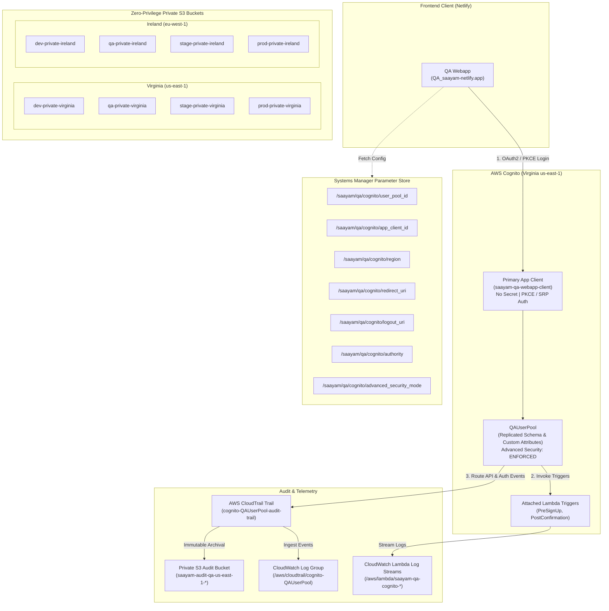

# QA Cognito User Pool Replication & Private Storage Architecture

**Issue Reference:** [#65: Create QAUserPool in Cognito replicating the DevUserPool (without users) to implement and test Cognito Advanced Security Features](https://github.com/saayam-for-all/devsecops/issues/65)  
**Author:** DevSecOps Team  
**Scope:** Replication of `DevUserPool` schema into `QAUserPool`, activation of Cognito Advanced Security Features (`ENFORCED`), CloudTrail event routing, CloudWatch log streams for Lambda triggers, multi-region zero-privilege private S3 buckets across Virginia (`us-east-1`) and Ireland (`eu-west-1`), and Netlify Webapp parameter exports into SSM Parameter Store under `/saayam/qa/cognito/*`.

---

## 1. Architecture Overview

The QA environment implements an isolated, hardened authentication and storage infrastructure replicating the production-bound schemas of development while enabling advanced threat detection, zero-privilege storage, and automated audit trails.



---

## 2. DevUserPool vs. QAUserPool Configuration Comparison

The `QAUserPool` replicates all schema definitions, password policies, MFA configurations, and custom attributes from `DevUserPool`, but starts with a **clean user database (zero user migration)** to enable non-destructive penetration testing, compromised credential testing, and adaptive authentication verification.

| Configuration Area | DevUserPool (`dev`) | QAUserPool (`qa`) | Rationale / Security Standard |
| :--- | :--- | :--- | :--- |
| **Cognito Advanced Security Features** | `OFF` | **`ENFORCED`** | Prevents unexpected per-MAU AWS licensing costs during dev, while enforcing threat protection (compromised credential checks, IP risk scoring, adaptive MFA) in QA. |
| **User Data Migration** | Contains active dev users | **No users migrated (clean slate)** | Prevents PII leakage and enables controlled simulation of credential-stuffing attacks without impacting existing user accounts. |
| **App Client Target** | Local development (`http://localhost:3000`) & Dev endpoints | **`QA_saayam-netlify.app`** | Scoped redirect URIs to prevent open redirect vulnerabilities (`callback_urls` and `logout_urls`). |
| **Client Secret** | Not generated (`generate_secret = false`) | **Not generated (`generate_secret = false`)** | Public SPA clients (React on Netlify) cannot safely protect client secrets in browser memory. |
| **Prevent User Existence Errors** | `ENABLED` | **`ENABLED`** | Mitigates user enumeration attacks during login/recovery flows. |
| **Standard Attributes** | `email` (required, verified), `name`, `phone_number`, `given_name`, `family_name` | **Identical clone** | Ensures 100% API parity for authentication tokens between dev and QA environments. |
| **Custom Attributes** | `custom:role`<br/>`custom:organization_id`<br/>`custom:volunteer_id`<br/>`custom:kyc_verified` | **Identical clone** | Ensures identical claim structures in JWT IdTokens and AccessTokens. |
| **Password Policy** | Min 8 chars, lowercase, uppercase, numbers, symbols; 7-day temp pw | **Identical clone** | Matches baseline password complexity. |
| **MFA Configuration** | `OPTIONAL` (TOTP Software Token) | **`OPTIONAL` (TOTP Software Token)** | Allows adaptive authentication to challenge high-risk logins with TOTP. |
| **Audit Event Routing** | Disabled / Basic AWS logs | **CloudTrail + CloudWatch Logs Group** | All Cognito management and data plane operations are routed to CloudTrail and CloudWatch for real-time alerting. |
| **Lambda Trigger Logs** | Default console logs | **Dedicated CloudWatch Log Streams** | Log streams are pre-provisioned under `/aws/lambda/*` with 90-day retention. |

---

## 3. CloudWatch & CloudTrail Audit Verification Steps

Cognito auditing in QA captures both **Management Events** (pool settings modifications, client updates) and **Data Plane Events** (`InitiateAuth`, `SignUp`, `RespondToAuthChallenge`, `ForgotPassword`).

### 3.1 Verifying CloudTrail Trail Status
Run the following AWS CLI command to verify that the Cognito trail is actively logging:
```bash
aws cloudtrail get-trail-status \
  --name cognito-QAUserPool-audit-trail \
  --region us-east-1
```
Expected output:
```json
{
    "IsLogging": true,
    "LatestDeliveryTime": "2026-10-27T11:20:00Z",
    "StartLoggingTime": "2026-10-27T11:00:00Z"
}
```

### 3.2 Querying CloudTrail Logs in CloudWatch Logs Insights
Navigate to **CloudWatch > Logs Insights** in the AWS Console, select log group `/aws/cloudtrail/cognito-QAUserPool`, and run:

#### A. Detect High-Risk or Blocked Logins (Cognito Advanced Security):
```sql
fields @timestamp, eventName, userIdentity.userName, responseElements.riskEvaluation.riskLevel, sourceIPAddress, userAgent
| filter eventSource = "cognito-idp.amazonaws.com"
| filter responseElements.riskEvaluation.riskLevel in ["MEDIUM", "HIGH"] or eventName = "AdminInitiateAuth"
| sort @timestamp desc
| limit 50
```

#### B. Audit Failed Sign-Ins and Challenges:
```sql
fields @timestamp, eventName, errorMessage, userIdentity.userName, sourceIPAddress
| filter eventSource = "cognito-idp.amazonaws.com"
| filter errorMessage like /Incorrect username or password/ or errorMessage like /Password reset required/
| stats count(*) as FailureCount by sourceIPAddress, userIdentity.userName
| sort FailureCount desc
```

### 3.3 Verifying CloudWatch Log Streams for Lambda Triggers
Attached Cognito Lambda triggers write execution logs directly to dedicated log groups:
- `/aws/lambda/saayam-qa-cognito-pre-sign-up`
- `/aws/lambda/saayam-qa-cognito-post-confirmation`

Check the log streams via CLI:
```bash
aws logs describe-log-streams \
  --log-group-name /aws/lambda/saayam-qa-cognito-pre-sign-up \
  --region us-east-1
```

---

## 4. Regional Hardened Private S3 Bucket Inventory

All regional environment buckets are configured with zero public access, default encryption, versioning, and strict zero-privilege bucket policies.

### 4.1 Bucket Inventory Table

| Bucket Name | Region | Environment | Encryption | Public Access Block | Ownership Control | Zero-Privilege TLS Policy |
| :--- | :--- | :--- | :--- | :--- | :--- | :--- |
| `dev-private-virginia` | `us-east-1` (Virginia) | `dev` | SSE-S3 AES256 | All 4 Rules Enforced | `BucketOwnerEnforced` | Deny HTTP / TLS < 1.2 |
| `qa-private-virginia` | `us-east-1` (Virginia) | `qa` | SSE-S3 AES256 | All 4 Rules Enforced | `BucketOwnerEnforced` | Deny HTTP / TLS < 1.2 |
| `stage-private-virginia` | `us-east-1` (Virginia) | `stage` | SSE-S3 AES256 | All 4 Rules Enforced | `BucketOwnerEnforced` | Deny HTTP / TLS < 1.2 |
| `prod-private-virginia` | `us-east-1` (Virginia) | `prod` | SSE-S3 AES256 | All 4 Rules Enforced | `BucketOwnerEnforced` | Deny HTTP / TLS < 1.2 |
| `dev-private-ireland` | `eu-west-1` (Ireland) | `dev` | SSE-S3 AES256 | All 4 Rules Enforced | `BucketOwnerEnforced` | Deny HTTP / TLS < 1.2 |
| `qa-private-ireland` | `eu-west-1` (Ireland) | `qa` | SSE-S3 AES256 | All 4 Rules Enforced | `BucketOwnerEnforced` | Deny HTTP / TLS < 1.2 |
| `stage-private-ireland` | `eu-west-1` (Ireland) | `stage` | SSE-S3 AES256 | All 4 Rules Enforced | `BucketOwnerEnforced` | Deny HTTP / TLS < 1.2 |
| `prod-private-ireland` | `eu-west-1` (Ireland) | `prod` | SSE-S3 AES256 | All 4 Rules Enforced | `BucketOwnerEnforced` | Deny HTTP / TLS < 1.2 |

### 4.2 Security Controls Applied to Every Bucket
1. **Public Access Block (`aws_s3_bucket_public_access_block`)**:
   - `block_public_acls = true`
   - `block_public_policy = true`
   - `ignore_public_acls = true`
   - `restrict_public_buckets = true`
2. **Object Ownership**:
   - `object_ownership = "BucketOwnerEnforced"` (completely eliminates Access Control Lists).
3. **Data At-Rest Encryption**:
   - AES256 server-side encryption with S3 Bucket Key enabled (`bucket_key_enabled = true`).
4. **Enforced Zero-Privilege Bucket Policy**:
   ```json
   {
     "Version": "2012-10-17",
     "Statement": [
       {
         "Sid": "EnforceTLSRequestsOnly",
         "Effect": "Deny",
         "Principal": "*",
         "Action": ["s3:GetObject", "s3:PutObject", "s3:ListBucket", "s3:DeleteObject"],
         "Resource": ["arn:aws:s3:::qa-private-virginia", "arn:aws:s3:::qa-private-virginia/*"],
         "Condition": { "Bool": { "aws:SecureTransport": "false" } }
       },
       {
         "Sid": "EnforceTLSVersion",
         "Effect": "Deny",
         "Principal": "*",
         "Action": ["s3:GetObject", "s3:PutObject", "s3:ListBucket"],
         "Resource": ["arn:aws:s3:::qa-private-virginia", "arn:aws:s3:::qa-private-virginia/*"],
         "Condition": { "NumericLessThan": { "s3:TlsVersion": "1.2" } }
       }
     ]
   }
   ```

---

## 5. Web App Connection Guide for `QA_saayam-netlify.app`

### 5.1 Systems Manager (SSM) Parameter Store Hierarchy
All parameters are published under the team hierarchy established in Issue #74 (`/saayam/qa/cognito/*`):

| Parameter Path | Type | Value / Source | Description |
| :--- | :--- | :--- | :--- |
| `/saayam/qa/cognito/user_pool_id` | `String` | Output `qa_user_pool_id` | Cognito User Pool ID |
| `/saayam/qa/cognito/app_client_id` | `String` | Output `qa_app_client_id` | Cognito App Client ID (Public SPA) |
| `/saayam/qa/cognito/client_id` | `String` | Output `qa_app_client_id` | Alias for OIDC SDK integration |
| `/saayam/qa/cognito/region` | `String` | `us-east-1` | AWS Region hosting the pool |
| `/saayam/qa/cognito/redirect_uri` | `String` | `https://QA_saayam-netlify.app/callback` | OAuth redirect callback URL |
| `/saayam/qa/cognito/logout_uri` | `String` | `https://QA_saayam-netlify.app/logout` | OAuth logout callback URL |
| `/saayam/qa/cognito/app_url` | `String` | `https://QA_saayam-netlify.app` | Netlify QA Web App base URL |
| `/saayam/qa/cognito/authority` | `String` | `https://cognito-idp.us-east-1.amazonaws.com/{user_pool_id}` | OIDC Identity Issuer URL |
| `/saayam/qa/cognito/advanced_security_mode` | `String` | `ENFORCED` | Active threat detection mode |

### 5.2 Fetching SSM Parameters into Netlify Build Environment
Add the following command to your Netlify build script or CI environment to pull the latest QA parameters directly from AWS Systems Manager:

```bash
# Export all parameters under /saayam/qa/cognito to .env.production
aws ssm get-parameters-by-path \
  --path "/saayam/qa/cognito" \
  --region us-east-1 \
  --query "Parameters[*].[Name,Value]" \
  --output text | while read -r name value; do
    key=$(basename "$name" | tr '[:lower:]' '[:upper:]')
    echo "VITE_COGNITO_${key}=${value}" >> .env.production
done
```

### 5.3 Frontend Authentication Integration Example
In your React/Vite application hosted on `QA_saayam-netlify.app`:

```javascript
// src/auth/cognitoConfig.js
import { Amplify } from 'aws-amplify';

Amplify.configure({
  Auth: {
    Cognito: {
      userPoolId: import.meta.env.VITE_COGNITO_USER_POOL_ID,
      userPoolClientId: import.meta.env.VITE_COGNITO_APP_CLIENT_ID,
      signUpVerificationMethod: 'code',
      loginWith: {
        oauth: {
          domain: 'saayam-qa-auth.auth.us-east-1.amazoncognito.com',
          scopes: ['email', 'openid', 'phone', 'profile', 'aws.cognito.signin.user.admin'],
          redirectSignIn: [import.meta.env.VITE_COGNITO_REDIRECT_URI || 'https://QA_saayam-netlify.app/callback'],
          redirectSignOut: [import.meta.env.VITE_COGNITO_LOGOUT_URI || 'https://QA_saayam-netlify.app/logout'],
          responseType: 'code'
        }
      }
    }
  }
});
```

---

## 6. Deployment & Verification Runbook

### Deploying the QA Environment
```bash
cd terraform/environments/qa
terraform init
terraform plan -var-file="us-east-1.tfvars.example"
terraform apply -var-file="us-east-1.tfvars.example"
```

### Deploying the Multi-Region Topology (Virginia + Ireland)
```bash
cd terraform/environments/multi-region
terraform init
terraform plan -var-file="terraform.tfvars.example"
terraform apply -var-file="terraform.tfvars.example"
```
